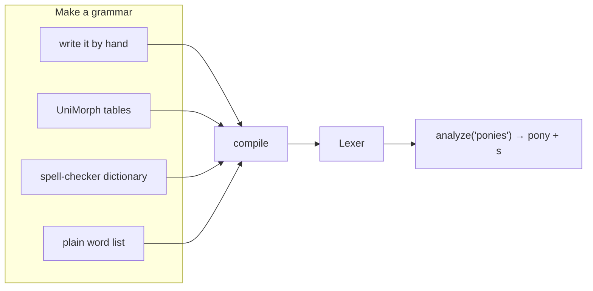

# morph-fst

A Rust library that tells you what a word is made of:

```text
unhappiness   →  un + happy + ness          prefix, adjective stem, noun ending
evlerimizden  →  ev + ler + imiz + den      Turkish: house + plural + our + from
blorties      →  blorty + s                 never seen; the stem change comes from city/cities
```

You describe a language once, in a plain-text `.morph` grammar: its stems, the endings each kind of stem takes, and the spelling rules between them. The library compiles that into one fast lexer. The lexer analyzes the words the grammar knows, guesses the ones it doesn't from similar known words, and splits anything else into subword pieces. Results are ranked by fixed rules, never by trained weights: the grammar is the model.

It ships with full grammars for English, Turkish, Spanish, French and Korean, built from permissively licensed lexicons ([accuracy on real text](docs/results.md#real-text-in-the-other-bundled-languages)), a small Igbo grammar, and tools that write a first grammar for other languages from free data.



## Install

morph-fst is not on crates.io yet; install it from GitHub. Rust 1.82 or newer.

As a library, in your project:

```sh
cargo add morph-fst --git https://github.com/CoderDayton/morph-fst
```

or by hand in `Cargo.toml` (add `rev = "<commit>"` to pin a version):

```toml
[dependencies]
morph-fst = { git = "https://github.com/CoderDayton/morph-fst" }
```

The command-line tool:

```sh
cargo install --git https://github.com/CoderDayton/morph-fst
morph-fst --help
```

The six bundled languages are compiled into the library, so they need no data download.

## Use

```rust
use morph_fst::{Kind, Lexer};

let lx = Lexer::bundled("english")?;

let word = lx.analyze("unhappiest");
assert_eq!(word.kind(), Kind::Known);
assert_eq!(word.lemma(), "unhappy");
assert_eq!(word.tokens(), ["un<PFX:NEG>", "happy<ADJ>", "est<SUP>"]);

for word in lx.analyze_text("They visited Blorfing yesterday") {
    println!("{} {:?} {}", word.text(), word.kind(), word.lemma());
}
```

| You want | Call |
|---|---|
| A ready-made language | `Lexer::bundled("english")` |
| A new language from data | `Lexer::builder().unimorph(&tables).build()` |
| One word | `lx.analyze(word)` |
| Running text | `lx.analyze_text(text)` |
| Tokens: words, morphemes, lemmas or model pieces | `lx.split(text, Split::Pieces)` → `un ##happi ##est` |
| Search: rank documents by shared lemmas (BM25) | `lx.index(docs).search(query)` |
| Save and reload | `lx.save(path)`, `Lexer::load(path)` |

From the command line (see [Install](#install)):

```sh
morph-fst tokenize --spec english "unhappiness blorfing"
morph-fst new rus -o russian.mcfu      # downloads UniMorph's Russian table and builds a lexer
```

## Docs

- [How it works](docs/how-it-works.md): the idea, the two modes, where the code lives, limitations.
- [Guide](docs/guide.md): the API, tokenizer, search, building a language, command line, bundled languages.
- [The grammar language](docs/grammar.md): writing a `.morph` file.
- [Results](docs/results.md): accuracy on real English and 18 languages, speed, how it is tested.
- [Changelog](CHANGELOG.md)

## License

The code is licensed under the [Apache License, Version 2.0](LICENSE).

The English lexicon in `data/english.morph` is derived from ESDB, Copyright 2000-2026 by Kevin Atkinson, under a permissive MIT-like license; the full notice is in [data/english-ESDB-COPYRIGHT.txt](data/english-ESDB-COPYRIGHT.txt) and at the top of the spec.

The other bundled lexicons are derived from third-party data under their own licenses, each notice in `data/` and at the top of its spec:

- Turkish (`data/turkish.morph`): Zemberek-NLP, Apache-2.0 ([notice](data/turkish-ZEMBEREK-LICENSE.txt)).
- Spanish (`data/spanish.morph`): RLA-ES, used under MPL-1.1 ([license](data/spanish-RLA-ES-LICENSE.txt)).
- French (`data/french.morph`): Grammalecte, MPL-2.0 ([license](data/french-GRAMMALECTE-LICENSE.txt)).
- Korean (`data/korean.morph`): mecab-ko-dic, Apache-2.0 ([license](data/korean-MECAB-KO-DIC-LICENSE.txt)).
