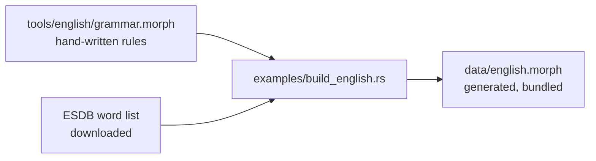

# How it works

## The idea

A plain lexical analyzer is a dictionary: it knows `walked = walk + PAST` because someone listed it, and it knows nothing about a word it has not seen. morph-fst replaces the list with a **grammar**: stems, the endings each stem class takes, and the spelling rules between them. Every known word is a path through that grammar.

You write a language's morphology once, as a plain-text `.morph` spec ([the grammar language](grammar.md)). The crate compiles it into one automaton (a char trie with morpheme payloads, finite-state morphotactics and harmony registers) that reads each word in one left-to-right scan. For every word it:

1. **parses it** into known roots and affixes if the grammar accepts it:
   - `unhappiness → un<PFX:NEG>+happy<ADJ>+ness<NMLZ>`
   - `evlerimizden → ev<N>+lAr<PL>+IxmIz<P1PL>+DAn<ABL>` (Turkish vowel harmony)
   - `ịga → I<INF>+ga<V:go>` vs `iri → I<INF>+ri<V:eat>` (Igbo prefixes agree with the root after them)
2. **otherwise splits it deterministically** into WordPiece subwords (LinMaxMatch, linear time). The vocabulary is derived from the grammar. It never fails and never emits `[UNK]`; unknown characters become bytes.
3. **for a word it has never seen (hybrid mode)** reads the unknown stem against the stems it knows and returns every reading the grammar supports, best first:
   - `blorties → ⟨blortie→blorty⟩<?N> + s<PL>` (the stem takes `y→ie` from *city*, *party*)
   - `bloglarımda → ⟨blog⟩<?N> + lAr<PL> + Ixm<P1SG> + DA<LOC>`
   - `gekauft → ⟨gekauft→kaufen⟩<?V;V.PTCP;PST>` (German, from tables with only *gemacht*, *gesagt*, *gelegt*: the `ge-` and `-en` come from those stems)

Two layers sit on top. In running text, the grammar's `PREFER` rules pick each word's reading from its neighbours, and a tokenizer handles numbers, URLs and punctuation. The search is ranked lexicographically, never by weights. The lexer learns nothing at run time: data may draft a grammar (tables, dictionaries, treebanks), but what it runs is plain spec text.

## The two modes

| Mode | Known word | Unknown word |
|---|---|---|
| `Strict` | full analysis (`stopped → stop<V>+ed<PST>`) | WordPiece subwords (`bl ##orf ##ing`); never fails |
| `Hybrid` | identical to strict | ranked analyses with a guessed stem, its lemma and class (`blopped → ⟨blopp→blop⟩<?V> + ed<PST>`); subwords only if nothing fits |

Use `Strict` when you want only analyses the grammar fully licenses; use `Hybrid` for open text, where new words are the norm.

By default an unknown word is **guessed** (`Mode::Hybrid`, `Kind::Guessed`). `Mode::Strict` leaves it **unsplit** into subword pieces (`Kind::Unsplit`) instead. Numbers, URLs, emails, abbreviations, clitics, punctuation and symbols are `Kind::Literal`: kept whole, never looked up. A capitalized unknown word in mid-sentence is a `Kind::Name`: kept whole, so `Texas` is not `Texa` + `s`.

## The lexicon is the model

Unknown words are handled by the same grammar that analyzes known ones. There is no second model, no training run and no tuned weight. Each piece follows from one idea: **every word is a path through the grammar, and an unknown word is a path whose stem borrows its ending from known stems.**

- **Zero morphemes** (`0 SG # ;`). A paradigm cell with no ending (*cat* = cat + SG) is a real morpheme with a tag. Without it a bare word has nothing to carry its features, and 60% of English forms are bare.
- **Stem shapes.** Every ending of every known stem is a shape: `ity → ity` from *city*, `opp → op` from *stopp-ed*. A shape remembers the stem's class, its spelling-rule flags and the lemma change, so an unknown stem that ends the same way inherits all three. Shapes come from the compiled grammar, so rules apply to unknown stems exactly as to known ones.
- **One example is an anecdote.** A shape needs two distinct known stems (`MIN_SUPPORT`). That is the only constant.
- **Irregular stems are not patterns.** A stem whose lemma has forms listed whole (*go*, *went*) lends no shapes; *zak* should not inherit *take*'s past.
- **Ranking is lexicographic, not weighted.** Readings are ordered by (characters left unexplained, lexical exceptions, −stems supporting the shape, morphemes). The longest borrowed ending wins; among equals, the pattern more stems share wins. Every reading is returned, not just the first.

How well this does on unseen words is in [Results](results.md#unseen-words).

## Why one lexer

A morphological analyzer with a subword fallback is usually two things: an FST and a separately compiled WordPiece model. That means two compile loops, two artifacts, and two sources that can drift apart. Here the subword vocabulary is derived from the grammar. Morphemes and pieces go into **one trie in one loop**, the failure links come from **one BFS**, and the morphological walkers and LinMaxMatch run in **one scan**. The result is one file, and nothing that can drift.

Underlying-form harmony and exception learning are **not** separate modes or add-ons. They are part of the same compiler, artifact format and scan. Each language's spec declares whether it uses them (`OPTION harmony underlying`, `INDUCE …`), because they are facts about that language. When a spec doesn't use a feature, its code never runs.

## The bundled English

`data/english.morph` is generated, not hand-written. Two inputs:

- **The grammar**, `tools/english/grammar.morph` (about 500 lines, written by hand): prefixes, inflection and derivation classes, 21 spelling rules, the function words, and the `PREFER` context rules.
- **The lexicon**, from [ESDB](https://github.com/en-wl/wordlist) (the English Speller Database, formerly SCOWL v2; MIT-like license). It supplies every open-class lemma of size 60 or less (ESDB's default spell-checker size, American spelling) with its part of speech and inflected forms.



`examples/build_english.rs` fits the two together:

1. Each lemma gets the class and spelling-rule flag that reproduce its ESDB inflections. The lexer itself checks every candidate: `stop` → `@double`, `panic` → `@ck`, `knife` → `@ves`.
2. Forms no class reproduces are listed whole (*went*, *mice*, *better*): 1,521 of them.
3. A verb takes `-ment`, `-ion`, `-ation` or `-able` only when ESDB has the derived word (*movement* → `move` gets `-ment`).
4. Words the grammar derives transparently from another stem are left to the grammar (*happiness*, *unhappy*, *quickly*): 7,673 of them.

The result is 23k nouns, 6.6k verbs, 8.7k adjectives and 680 adverbs. Never edit `data/english.morph` by hand; edit the grammar and regenerate:

```sh
git clone --depth 1 https://github.com/en-wl/wordlist
cargo run --release --example build_english -- wordlist/data/scowl-pre.txt > data/english.morph
```

## Where the code lives

```
src/
  lib.rs                the public API: re-exports, and the crate docs
  engine/               reads a grammar and splits words
    spec/                 parser + compiler: registers, archiphonemes, rules, guards, pins, pruning, zero morphemes
    morphotactics.rs      which morpheme may follow which; register tables, guards, pins
    fused/                the Lexer: builder (one loop), scan, hybrid search, saved artifact
    lattice.rs            every reading of a word, ranked
    shapes.rs             stem shapes: what unknown stems borrow from known ones
    subword/              trie + failure links, LinMaxMatch, naive reference
    codec.rs              saving and loading files
    oracle.rs             independent reference interpreter (for tests)
  text/                 text in, results out
    tokenize.rs           splitting running text into tokens
    pretok.rs             the simple split: whitespace, and each punctuation mark alone
    normalize.rs          case folding, composed characters, tone and vowel marks
    word.rs               Word, Part, Kind: the everyday view of a result; PREFER rules
    output.rs             the precise result types (WordOutput)
  makers/               write a grammar from data
    build.rs              LexerBuilder: combines tables, dictionary, words, spec and corpus
    generate.rs           UniMorph tables → .morph
    hunspell.rs           Hunspell .aff/.dic → UniMorph rows
    discover.rs           word list → .morph (paradigm discovery)
    induce.rs             learning lexical exceptions from raw text
  languages.rs          the bundled grammars
  bin/morph-fst.rs      the command-line tool
data/                   bundled .morph grammars, Turkish sample corpus
tools/english/          the hand-written half of the English grammar
examples/               build_english (regenerates English), heldout and treebank
                        (accuracy), regress (English speed and exact-output check),
                        quickstart, search, learn_exceptions
tests/                  the test suite
docs/                   these pages
```

## Limitations

- **Ordering inside a morpheme.** Left-reading archiphonemes must come before right-reading ones, with at most one both-ways reader between them. In surface mode, a rule may not rewrite text that an archiphoneme in the same morpheme already read. Both are compile errors.
- **What rules can see.** Rules see the next morpheme's lexical form or first symbol; long-distance conditions go through FEATUREs.
- **Exception learning.**
  - It needs the root to occur with discriminating suffixes.
  - It learns one value per (root, feature).
  - In hybrid mode it explains one unknown stem per word.
- **Igbo is simplified.** Tones are ignored, and the negative is `-ghị` throughout.
- **One word of context.** `PREFER` rules see only the next word or the previous one, so a choice that needs the whole clause (`-ed` as past vs participle) is out of reach. `analyze` sees no context at all.
- **Hunspell import** reads affix rules, `AF` aliases, `FORBIDDENWORD` and `NEEDAFFIX`, in UTF-8 or ISO 8859-1/15. Compounding, `ICONV`/`OCONV` and morphological aliases are not read. Dictionaries that list inflected forms as stems of their own (German `de_DE_frami`) give weaker lemmas: 37.6% of UniMorph German forms, against 69.7% for Spanish `es_ES`.
- **Demo-sized bundled lexicons** for every language except English. UniMorph tables and UD treebanks (CC BY-SA) cannot be bundled with a permissively licensed crate, and Hunspell dictionaries carry licences of their own. `morph-fst new <code>` and `Lexer::builder().unimorph(..)` download the tables and build the full-size grammar measured in [Results](results.md).
- **English readings tie by entry order.** ESDB gives no frequency per part of speech, so among equally short readings adjectives come first, then nouns, then verbs (the order that scored best). In the raw lattice, lexicalized entries ESDB lists as words rank first (`making<N>` before `make<V>+ing<PROG>`); `Word` flips that for open-class entries, so `analyze` puts `make` + `ing` first (it scored better on real text).
- **Korean segments are in jamo.** A boundary inside a syllable shows as partial jamo.
- **Punctuation** detection covers ASCII and the main Unicode punctuation blocks (`std` has no Unicode category tables).

## References

- Song et al., *Fast WordPiece Tokenization*, EMNLP 2021 (LinMaxMatch). https://aclanthology.org/2021.emnlp-main.160
- Beesley and Karttunen, *Finite State Morphology*, 2003 (lexc continuation classes, two-level rules).
